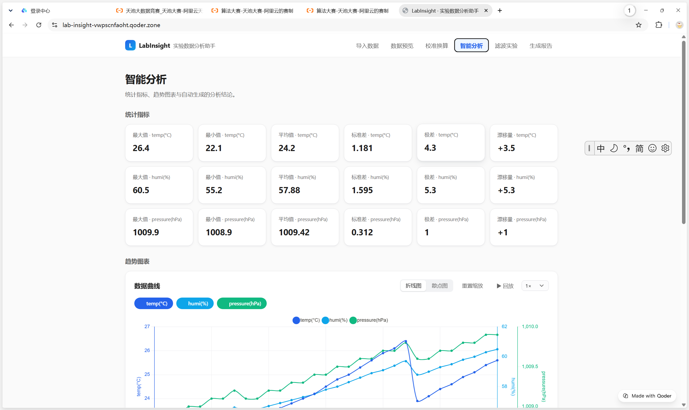
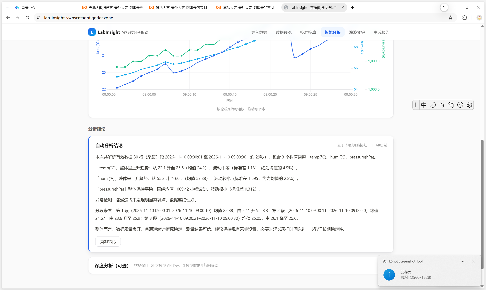
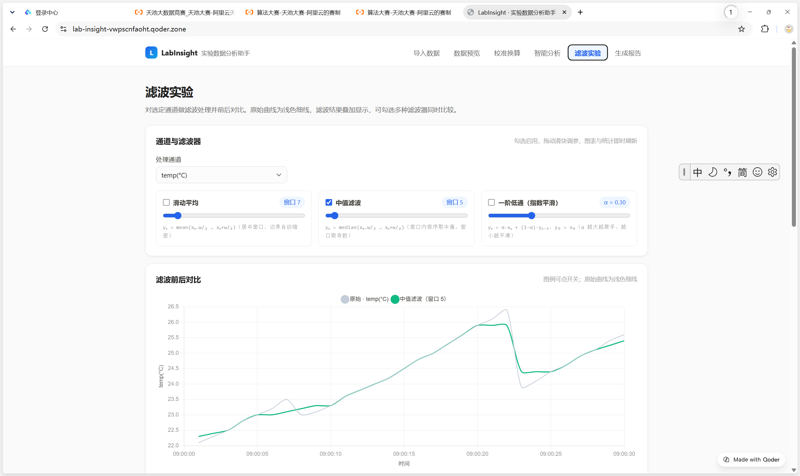
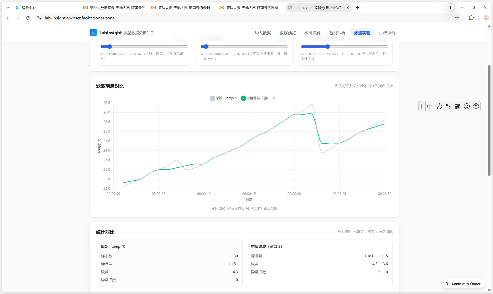
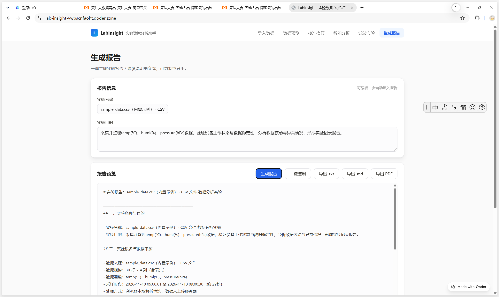
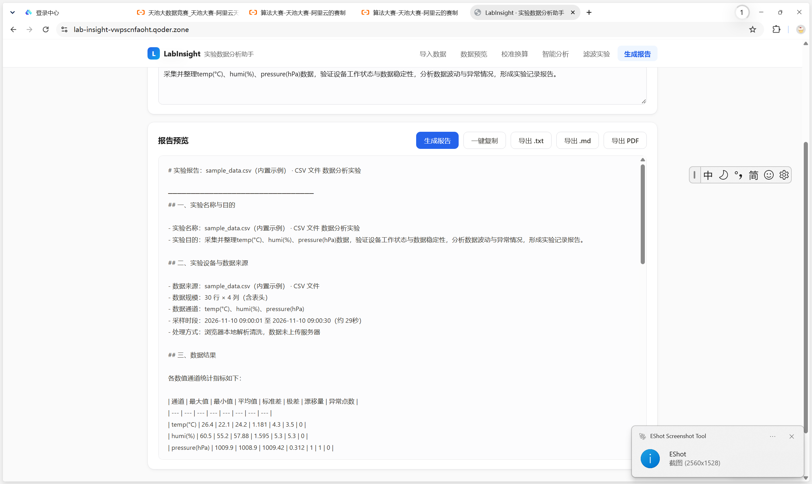
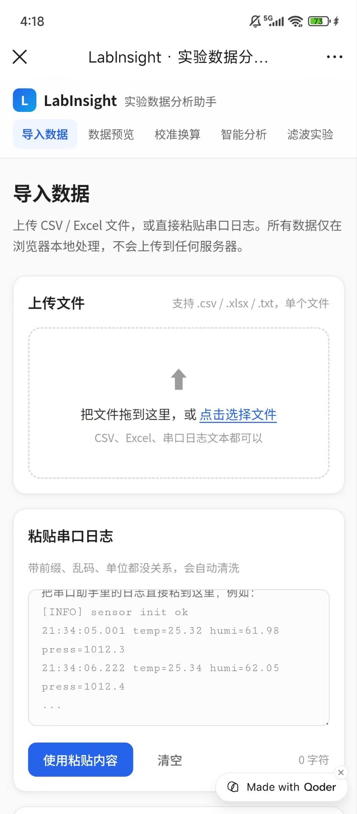

# LabInsight · 实验数据分析助手

> 把乱糟糟的串口日志或 CSV/Excel 丢进去，自动清洗、校准换算、可视化、滤波分析，最后生成一份能直接交的实验报告。
>
> 纯前端、零后端、零依赖安装，数据全程在浏览器本地处理不上传。

面向嵌入式 / 物联网方向的实验数据处理工作流，八个页签：七步数据处理 + 一个电路仿真页。

## 功能

| 页签 | 做什么 |
|---|---|
| **导入数据** | CSV/Excel 拖拽上传；串口日志直接粘贴（`[INFO]` 前缀、乱码行、CRC 失败帧自动清洗）；内置示例一键加载；**实时串口采集**（Web Serial 直连开发板，边采边看多 Y 轴实时曲线、采集时按空格打标记，无硬件可用模拟数据流体验完整流程，可向设备下发指令）；**虚拟仪表盘**（温度计 / 指针表盘 / 七段数码管，毛刺通道红色呼吸光）；**3D 数字孪生实验台**（实时数据驱动温度计与数码管，附接线挑战）；**多份同结构数据按行合并**（按列名对齐）；**实验项目库**（多个实验分别存快照，随时切换/重命名/删除），项目自动保存（IndexedDB），刷新可恢复，支持导出/导入项目 JSON |
| **数据预览** | 清洗后表格、数值列高亮、脏行清单与原始对照；**采样质量报告**（实际采样率、平均/标称间隔、间隔抖动、丢帧检测、时间戳一致性）；**数据体检卡**（缺失值/重复行/常数列检查，一键清理可撤销）；一键导出清洗后数据为 CSV / Excel |
| **校准换算** | 原始电信号 → 物理量：NTC 热敏电阻（B 值式 / Steinhart-Hart）、ADC 读数转电压（位数/Vref/分压系数）、MQ 系列 Rs/R₀ 与 ppm 近似；**线性拟合**（y = k·x + b，输出 R² 与评语）、**标定评估**（灵敏度/零点/线性度/迟滞）与**NTC 理论 R-T 曲线对比**；**自定义多项式换算**（y = ax+b / y = ax²+bx+c）；**两点标定**（两组标准温度-实测电阻反算 B 与 R₀，可从标定图首尾两点取值）；**NTC 型号预设**（B 值与 R₀ 一键填充）；公式与参数页面标注；批量换算生成新列 |
| **智能分析** | 统计卡片（含**标准误与 95% 置信区间**，t 分布口径标注）；多 Y 轴趋势图（折线/散点切换、滚轮缩放、曲线回放、300dpi PNG 与 **SVG 矢量导出**、**框选区间实时统计**）；**异常判定口径可切换**（3σ / IQR / 稳健 z-MAD，图上画阈值虚线）；**每通道直方图**；**SPC Xbar-R 控制图**（子组大小 2~10，±3σ 控制限与越界点标红，给判稳结论）；**通道相关系数矩阵**（Pearson r）；**测量不确定度计算**（A 类/B 类/合成/扩展）；**多组并列对比**（多组数据叠图 + 均值 ± 标准差带，支持粘贴或从文件选 CSV/Excel 加组；**组间显著性检验**：两组单次 Welch's t，三组以上两两比较 + Bonferroni 校正）；**图表误差棒**（每点 ±U 按通道）；**实验事件标注**（图上打点、可拍照关联、进报告）；**3D 数据星系**（多通道升维成 3D 地形，WASD 飞行、R 回放）与**异常猎人**（点晶体判真异常/误报，结果进报告流水）；**答辩演示模式**（全屏大字号翻页，键盘左右翻）；自动生成中文分析结论（趋势、波动分级、离群定位到时间戳、分段描述、行动建议） |
| **工具箱** | 嵌入式落地辅助：**生成 C 代码**（NTC B 值式+分度表 / Steinhart-Hart / ADC 转电压 / 多项式，读校准参数一键复制，可下载 `.h`）；**采样率/定时器助手**（STM32 PSC/ARR、Arduino OCR1A、过采样提示）；**分压电阻与 ADC 位数助手**（E24 阻值推荐）；**十六进制字节流解码**（ASCII / uint16 / int16）；**Arduino 完整示例**（按所选换算生成 .ino，一键下载即可烧录）；**自动模型辨识**（线性/二次/三次/指数/对数/幂/倒数七种候选自动竞选，反变换回原始空间算修正 R²）；**可复现实验包与数据指纹**（SHA-256 指纹 + zip 包，验证报告是否由这份数据经这条流水得出）；**无后端分享链接**（数据压进 URL，对方打开即恢复） |
| **滤波实验** | 滑动平均 / 中值滤波 / 一阶低通三种滤波器勾选叠加对比；处理前后标准差/极差/异常点数变化；**FFT 频域分析**（自实现基-2 Cooley-Tukey、主频次频自动标注、直流分量单独注明、奈奎斯特上限提示，**非均匀采样自动重采样后变换**） |
| **生成报告** | 一键套模板生成实验报告（名称目的/器材或数据来源/实验步骤/注意事项/数据记录说明/统计表/分析结论/实验事件记录/误差分析与讨论/附录，选填区块空则自动省略）；**仪器台账**（名称/型号/编号/精度允差/校准日期，与不确定度 B 类联动）；**报告模板一键预填**（温度传感器标定 / 通用采集）；复制、导出 txt/md、**Word（.docx，含真表格与嵌入图表）**、**单文件 HTML**、**PPT 答辩大纲**（6 页 Markdown，自动填数）、打印存 PDF（打印版自动附**图表附录**）；统计表可复制 **LaTeX**；全程操作流水自动写入报告，每步可复现 |
| **电路仿真** | 引脚级电路仿真：10 种元件（ESP32 DevKit-C / LED / 电阻 / 按钮 / 电位器 / 数码管 / LCD1602 / 蜂鸣器 / 滑动开关 / NTC），拖放搭建 + 点引脚连线，并查集解算网络电平；MCU 两种驱动方式——**规则引擎**（每个 GPIO 配常高/常低/交替翻转/PWM 呼吸/输入上拉，无代码执行面）与 **Python 脚本**（浏览器内跑真 CPython 3.12，`machine.Pin/ADC/PWM` 语义模拟，`time.sleep` 走异步不冻结输入）；4 通道示波器；**波形一键导出到分析链路**（仿真 → 统计/FFT/SPC/报告闭环）；diagram.json 与 Wokwi 互相导入导出 |

其他：页签符合 WAI-ARIA roles；色板采用 Okabe-Ito 色盲友好八色；超大数据（>2 万行）自动下放 Web Worker 解析，绘图用 LTTB 降采样（统计仍用全量数据）；**完全离线**——所有前端依赖（Chart.js / PapaParse / SheetJS / zoom / docx / JSZip / LZ-String / Three.js / Pyodide）已放入本地 `vendor/`，断网或校园网屏蔽 CDN 也能用，双击 `index.html` 即开；本地纯前端运行，数据不出浏览器。**注意**：电路仿真页的 Python 模式需通过 http 打开（Worker + WASM 受 file:// 限制），其余功能在 file:// 下完整可用。

## 截图

数据预览与采样质量报告：


智能分析（多 Y 轴，三通道各自独立量程）：



自动生成的中文分析结论：



校准换算（公式与参数可追溯）：


滤波前后对比：





FFT 频域分析：


生成报告：





手机端自适应：



## 快速开始

双击 `src/index.html` 即可运行，无需构建、无需安装依赖。

或起一个本地静态服务：

```bash
cd src
python -m http.server 8080
# 打开 http://localhost:8080
```

## 目录结构

```
├── src/                    源码（纯静态，双击 index.html 可运行）
│   ├── index.html          页面结构
│   ├── style.css           样式（含打印样式表）
│   ├── app.js              主逻辑与各页签渲染
│   ├── parser.js           解析与清洗引擎（CSV/Excel/串口日志）
│   ├── analysis.js         统计分析与采样质量分析
│   ├── spc.js              SPC 控制图（Xbar-R）
│   ├── calib.js            传感器校准换算（NTC/ADC/MQ）
│   ├── fit.js              最小二乘拟合
│   ├── modelid.js          自动模型辨识（七种候选竞选）
│   ├── repro.js            复现包 / 数据指纹 / 分享链接
│   ├── engine.js           Web Worker 大数据解析（engine-worker.js 同目录）
│   ├── filter.js           滤波器实现
│   ├── fft.js              FFT 实现
│   ├── serial.js           串口采集（Web Serial / 模拟）
│   ├── dashboard.js        虚拟仪表盘（SVG）
│   ├── galaxy.js           3D 数据星系与异常猎人（Three.js）
│   ├── bench.js            3D 数字孪生实验台
│   ├── sim.js              电路仿真内核（元件/连线/网络解算/波形）
│   ├── sim-py-worker.js    Python 执行 Worker（Pyodide + machine 模拟层）
│   ├── report.js           报告生成与 Markdown 渲染
│   ├── project.js          IndexedDB 项目库
│   ├── sample-data.js      内置示例数据
│   └── vendor/             离线依赖（Chart.js / PapaParse / SheetJS / zoom / docx / JSZip / LZ-String / Three.js / Pyodide）
├── samples/                示例数据文件
│   ├── sample_serial.txt   串口日志示例（含脏行与毛刺）
│   └── sample_data.csv     规整 CSV 示例
└── docs/
    ├── 需求说明书.md         功能规格
    ├── 验收报告.md           自动化验收记录
    ├── CHANGELOG.md        变更日志
    └── screenshots/        截图
```

## 技术栈

- 纯前端：HTML + CSS + JavaScript，无框架、无构建步骤
- [Chart.js](https://www.chartjs.org/) — 图表（多 Y 轴、缩放、回放）
- [PapaParse](https://www.papaparse.com/) — CSV 解析
- [SheetJS](https://sheetjs.com/) — Excel 读取
- [docx](https://github.com/dolanmiu/docx) — Word 导出
- [JSZip](https://stuk.github.io/jszip/) — 复现包打包
- [LZ-String](https://github.com/pieroxy/lz-string) — 分享链接压缩
- [Three.js](https://threejs.org/)（r149 UMD）— 3D 数据星系 / 实验台
- [Pyodide](https://pyodide.org/)（0.26.4，CPython 3.12 WASM）— 电路仿真页的 Python 脚本执行
- FFT — 本地自实现的迭代式基-2 Cooley-Tukey 算法（非外部依赖）
- 无后端、无数据库；数据全程在浏览器本地处理

## 数据与隐私

所有数据仅在你的浏览器内解析与计算，不发送到任何服务器。页面底部的「深度分析」为可选功能，需要你自行提供大模型 API Key，不填也可使用全部核心功能。

## 设计说明

- **解析引擎容错**：串口日志常见行首前缀、乱码、混用分隔符、带单位数值（`25.3C`）、多种时间戳格式、个别坏帧——逐行容错解析，脏行跳过并计数，不整体失败。
- **分析结论为本地规则引擎**：趋势判断、波动分级、离群检测、分段描述全部本地计算生成，不依赖任何模型接口。
- **校准公式可追溯**：每种换算在页面上写明所用公式与当前参数（如 `1/T = 1/T₀ + ln(R/R₀)/B`），换算是可复核的。

## 许可

MIT

